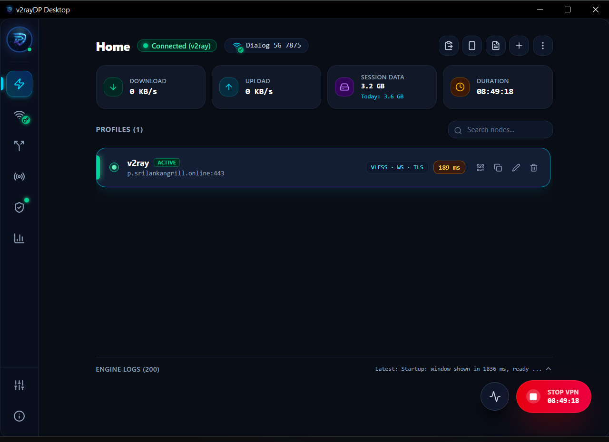
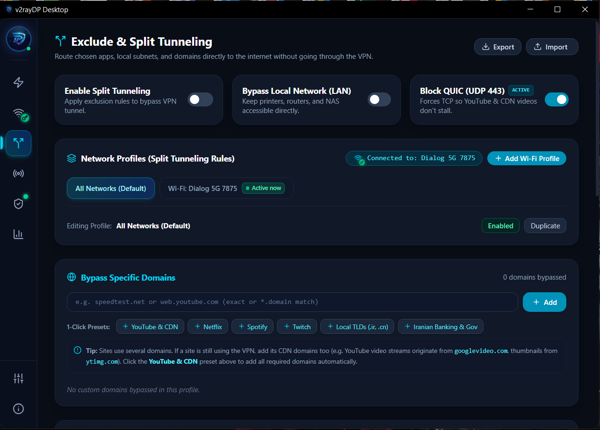
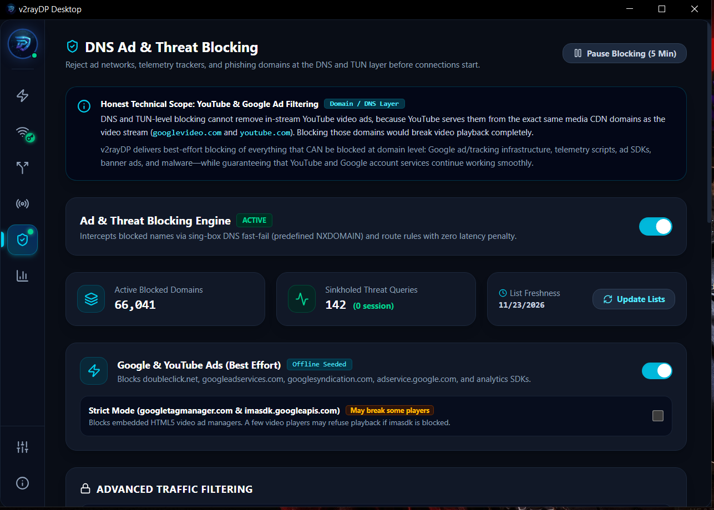
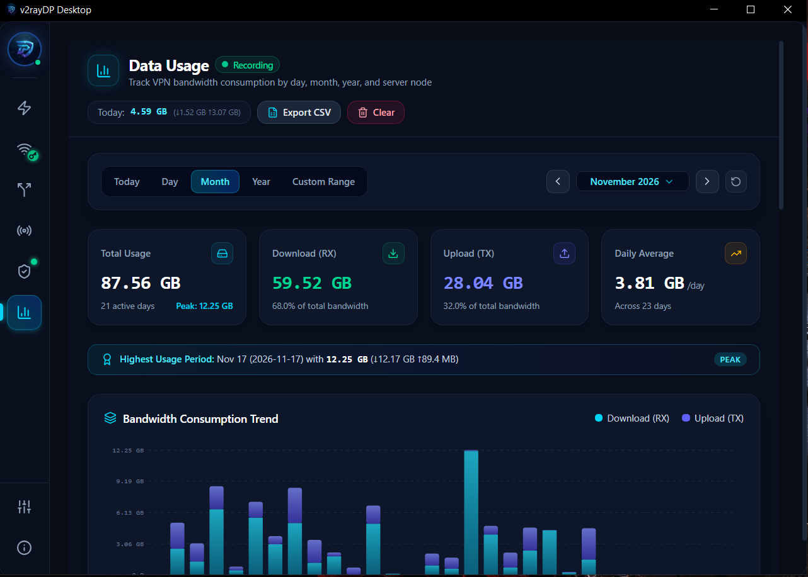
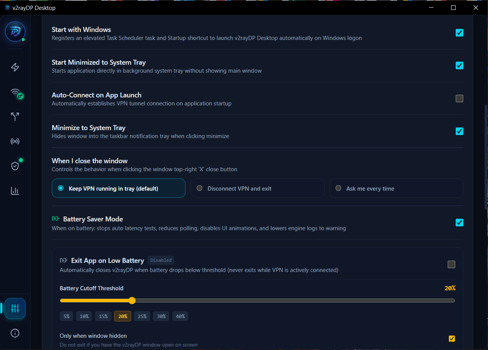

# 🚀 v2rayDP Desktop

A Windows desktop application built with **Electron**, **React**, **TypeScript**, and **Vite**[cite: 1, 2].

## 📸 Screenshots

| Overview | Additional Views |
| :---: | :---: |
| [cite: 2] | [cite: 2] |
| [cite: 2] | [cite: 2] |
| [cite: 2] | [cite: 2] |
| [cite: 2] | |

## ✨ What This App Does

* 🔗 **Proxy Link & Config Support**: Parses proxy/VMess links and handles configuration options for your setup[cite: 1].
* 🛡️ **Ad & Domain Blocking**: Normalizes domains and manages blocklist sources to block unwanted domains/ads[cite: 1].
* 🔀 **Split Tunneling**: Configures exclusions and traffic routing rules so selected apps or targets are handled separately[cite: 1].
* 📡 **Hotspot Controls**: Manages hotspot settings and controls right from the desktop app[cite: 1].
* 📱 **Phone Import**: Imports items from a phone using local server and QR modal workflows[cite: 1].
* 🤖 **Automation & System Guard**: Evaluates automation rules and monitors battery status, running processes, app freezes, window restoration, and system recovery[cite: 1].
* 📊 **Usage Analytics**: Aggregates and displays usage metrics across the dashboard and usage views[cite: 1].
* 🖥️ **Windows Integration & Packaging**: Includes Windows networking and elevation scripts, startup task scheduling, and installer packaging support[cite: 1].

## ⚠️ Disclaimer

Use this project responsibly and only in accordance with applicable laws, network policies, and terms of service.