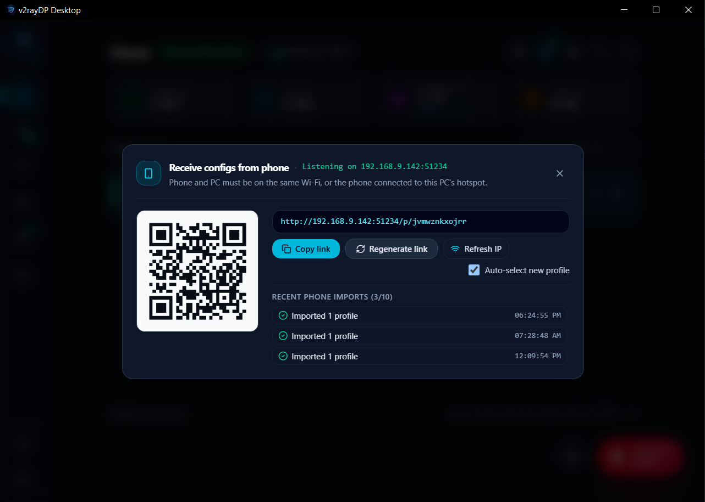

# 🚀 v2rayDP Desktop

A modern Windows desktop VPN client built with **Electron**, **React**, **TypeScript**, and **Vite**. Powered by **sing-box**, it combines profile management, SSID-based auto-connect rules, split tunneling, VPN hotspot sharing, DNS-level ad & threat blocking, and detailed bandwidth analytics in a clean dark interface.

---

### 🌟 What's Special in This Version

* 🔋 **New Battery Saving Options**: Added **Battery Saver Mode** (pauses auto-latency tests, reduces background polling, disables UI animations, and lowers engine log verbosity on battery power) alongside a configurable **Low-Battery Auto-Exit** threshold.
* 📱 **Direct Mobile Config Import**: Added a direct mobile import option to seamlessly transfer and import VPN configurations straight from your phone to the desktop app.
* 🛠️ **Automation System Bug Fixes**: Resolved reliability and rule-matching issues in the Master Automation Engine for smoother Wi-Fi SSID and LAN auto-connect behavior.
* 🌐 **Expanded Config Support**: Enhanced parser and profile handling to support a much wider variety of proxy configurations and formats.
* ⚡ **Improved Split Tunneling, Ad Blocking & Hotspot Sharing**: Upgraded traffic routing/bypass accuracy, DNS ad & threat blocking performance, and Windows Mobile Hotspot ICS sharing stability.

---

### 📸 Screenshots

| Home Dashboard | Direct Mobile Config Import |
| :---: | :---: |
|  |  |
| **Home Dashboard** — Real-time download/upload speeds, session data, latency, VLESS/WS/TLS profiles & live engine logs | **Direct Mobile Import** — Transfer and import VPN configurations directly from your mobile device to desktop |

| Master Automation Engine | Exclude & Split Tunneling |
| :---: | :---: |
|  |  |
| **Network Automation** — Auto-connect/disconnect rules based on active Wi-Fi SSID or LAN connections | **Exclude & Split Tunneling** — Per-network bypass rules, LAN bypass, QUIC (UDP 443) blocking & 1-click domain presets |

| Hotspot & Local Network Sharing | DNS Ad & Threat Blocking |
| :---: | :---: |
|  |  |
| **Hotspot & Network Sharing** — Share VPN via Direct ICS TUN bridging or local SOCKS5/HTTP proxy (`10808`) | **DNS Ad & Threat Blocking** — Fast-fail NXDOMAIN blocking with 66,000+ domains, tracker/ad filtering & strict mode |

| Data Usage Analytics | Application & Battery Settings |
| :---: | :---: |
|  |  |
| **Data Usage Analytics** — Daily, monthly & custom-range RX/TX charts, peak usage stats & CSV export | **Settings & Power Management** — Windows startup task, system tray behavior, Battery Saver Mode & low-battery auto-exit |

---

### ✨ Key Features

* ⚡ **Dashboard & Profile Management**: Monitor live download/upload speeds, session usage, connection duration, and server latency (`ms`) while managing multi-protocol proxy profiles with quick QR code, clipboard, and direct mobile import actions.
* 📱 **Direct Mobile Import**: Quickly send VPN links and configurations straight from your phone over local Wi-Fi without manual copy-pasting.
* 🤖 **Master Automation Engine**: Automatically triggers VPN actions (`Connect VPN`, `Do not connect`, etc.) using priority-ordered Wi-Fi SSID and LAN rules with fallback handling.
* 🔀 **Exclude & Split Tunneling**: Route selected apps, local LAN devices, or specific domains directly outside the VPN tunnel, complete with per-Wi-Fi rule profiles, QUIC (UDP 443) blocking, and 1-click presets (YouTube & CDN, Netflix, Spotify, Twitch, Local TLDs).
* 📡 **Hotspot & Local Network Sharing**: Share your encrypted VPN connection with phones, consoles, and smart TVs via **Direct ICS TUN Bridging** or a local **SOCKS5/HTTP Proxy** on port `10808`, with built-in diagnostics, auto-start, and disconnect recovery.
* 🛡️ **DNS Ad & Threat Blocking**: Block ads, telemetry trackers, and phishing/malware domains at the DNS & TUN layer via sing-box fast-fail (`NXDOMAIN`) with offline-seeded lists, live sinkhole counters, and optional Strict Mode.
* 📊 **Detailed Data Usage Analytics**: Track RX/TX bandwidth consumption across Today, Day, Month, Year, or Custom Ranges with daily averages, peak usage highlights, visual bar charts, and one-click CSV export.
* 🔋 **System Tray & Battery Saver Controls**: Launch silently on Windows startup via Task Scheduler, keep the VPN running in the system tray on close, enable Battery Saver Mode (pauses auto-latency checks, reduces polling, disables animations), and set a low-battery auto-exit threshold.

---

### ⚠️ Disclaimer

Use this software responsibly and only in accordance with applicable laws, network policies, and service terms.
